# LineForge 🚆

**Baue fiktive Städte und zeichne ihre Liniennetze – von der Straßenbahn bis zum ICE.**

LineForge ist eine Web-App (PWA, iPhone zuerst, läuft auch am Desktop), in der du eine Stadt auf einer 2D-Karte formst, Stationen setzt und Linien im Stil der Berliner und Münchner Netzpläne ziehst. Wenn du sehen willst, wie es in echt aussieht, schaltest du auf 3D um: Dort wachsen Gebäude aus dem Straßenraster, und deine Züge fahren auf Brücken, Viadukten und durch mehrgeschossige Bahnhöfe.

**Live ausprobieren:** [lineforge-app.vercel.app](https://lineforge-app.vercel.app)

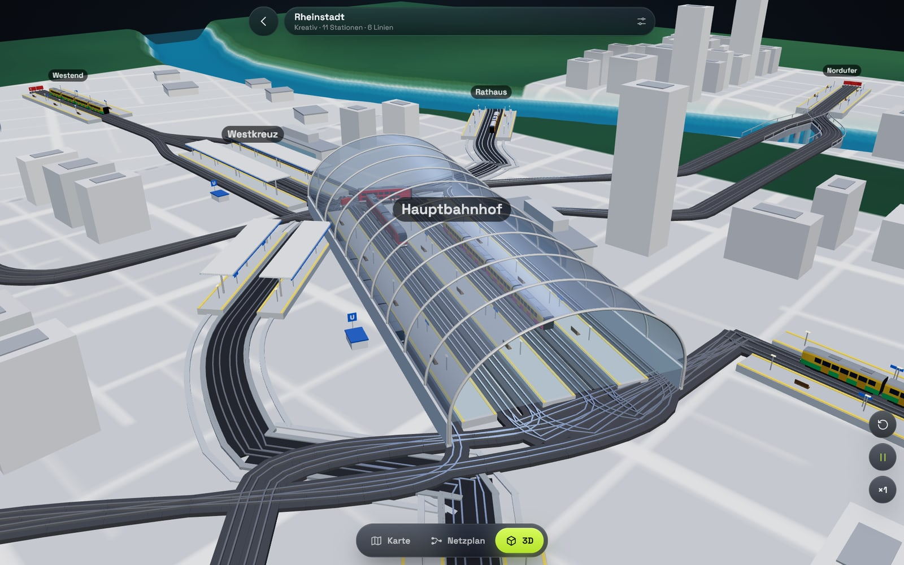

## Was kann es?

### Karte bauen
- **Terraforming:** Wasser und Land malen, Küsten und Flüsse sind weiche Konturen statt Pixel.
- **Gebiete:** Stadt, Vorort und Flughafen als Flächen. Die Stadt lässt sich in **benannte Bezirke** teilen.
- **Sehenswürdigkeiten:** Stadion, Wahrzeichen und Attraktionen als Marker (später Grundlage für Besucherströme).
- **Straßenraster:** Stadt und Vorort bekommen ein sauberes graues Straßennetz, das beim Hineinzoomen feiner wird.

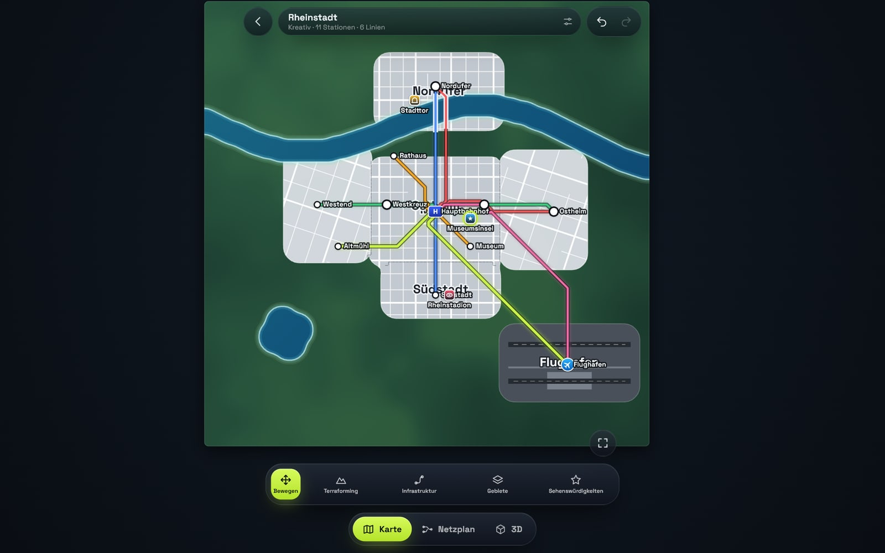

### Netz zeichnen
- **Linien mit freien Farben:** Der Betreiber (S-Bahn, U-Bahn, Straßenbahn, Nahverkehr, Fernverkehr) bestimmt nur Strichstärke und Zugtyp.
- **Automatisches Routing** in 45°-Schritten, das Wasser meidet und nicht an jeder Station knickt. Eigene Wegpunkte lassen sich setzen.
- **Straßenbahn auf der Straße:** Sie teilt sich nie die Gleise mit S-Bahn, U-Bahn oder Fernverkehr.
- **Netzplan:** Aus dem Netz entsteht automatisch ein Plan mit Legende, hell oder dunkel, als SVG oder PNG exportierbar.

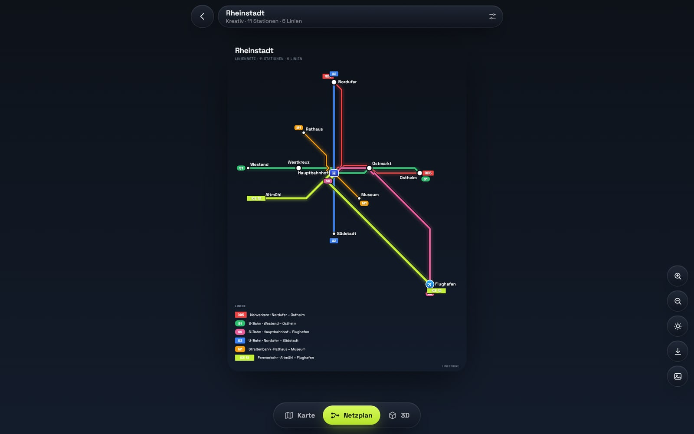

### In 3D erleben
- **Gleise und Brücken:** Schlichte Gleisbetten, Brücken über Wasser, Viadukte, wo sich Linien kreuzen.
- **Bahnhöfe nach Maß:** Gleise, Bahnsteigform, Länge und Dach sind einstellbar, auch **mehrere Ebenen** wie am Ostkreuz. Die Anzahl der Ebenen bestimmst du selbst, tiefere Ebenen werden abgesenkt, höhere aufgeständert.
- **Fahrende Züge:** Sie halten an den Bahnsteigen, wenden am Kopf, und kein Gleis wird doppelt belegt.
- **Gebäude als Quader:** Die Stadt wird hoch und dicht im Zentrum, Vororte bleiben niedrig. Gebäude weichen Gleisen und Bahnhöfen aus.

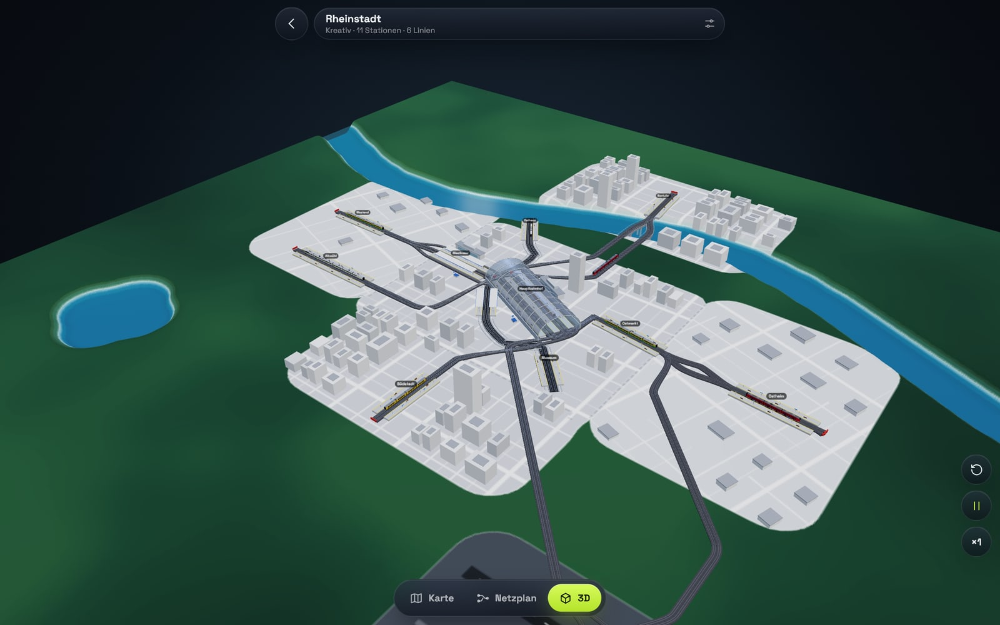

| | |
|---|---|
| 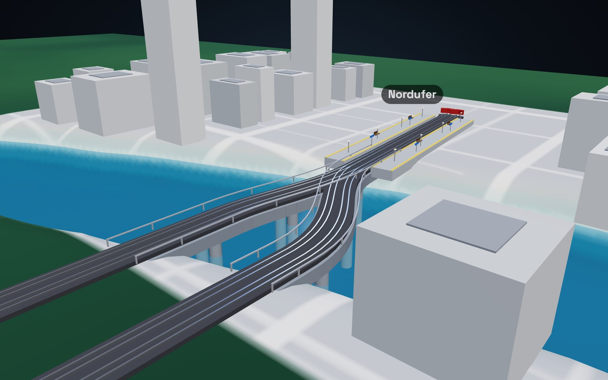 | 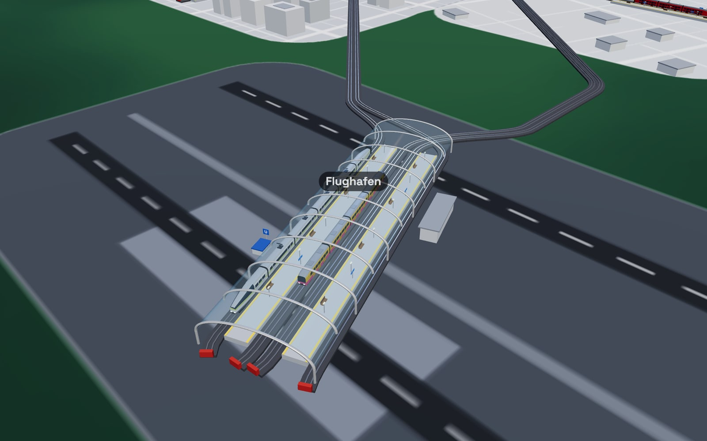 |
| Brücken entstehen automatisch, wo ein Gleis Wasser kreuzt. | Der Flughafen hat Start- und Landebahnen und einen eigenen Bahnhof. |

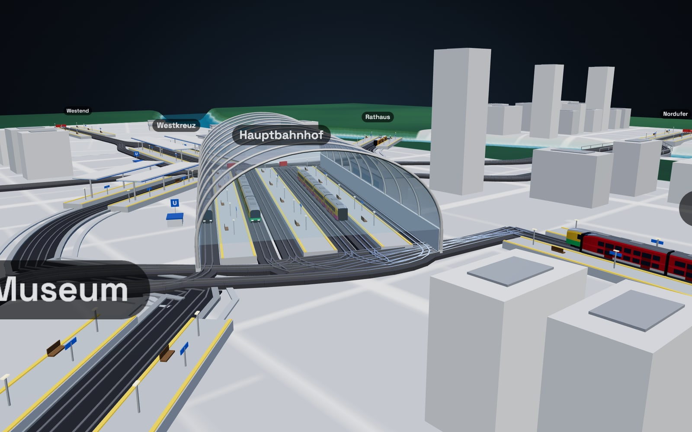

### Fahrzeuge
Fünf Fahrzeugtypen, modelliert nach echten Vorbildern und in der Linienfarbe lackierbar. Die Galerie findest du im Menü unter „Meine Städte“ → „Fahrzeuge“ oder unter `#fahrzeuge`.

| S-Bahn | U-Bahn | Straßenbahn |
|---|---|---|
| 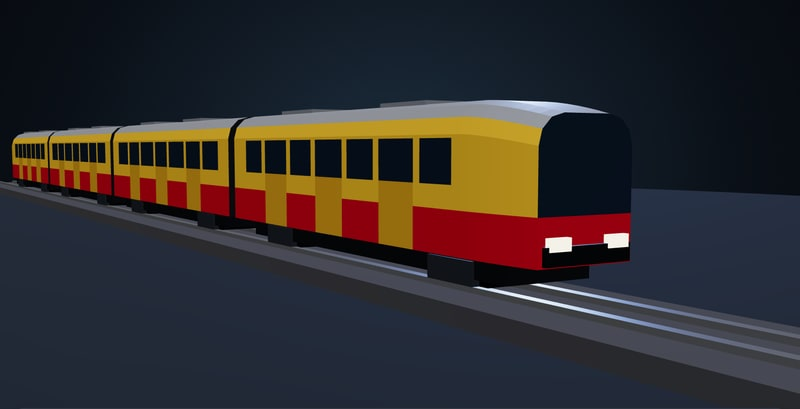 | 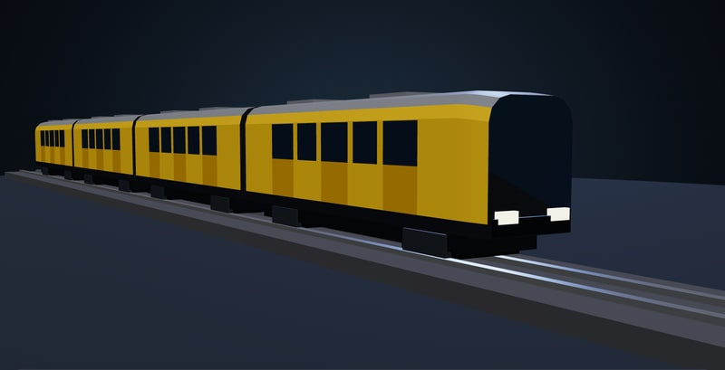 | 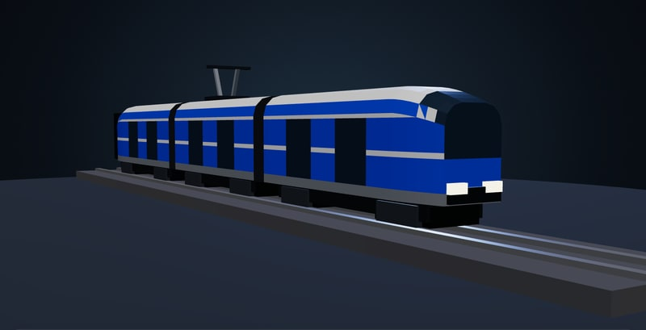 |

| Nahverkehr (Doppelstock) | Fernverkehr (ICE) |
|---|---|
| 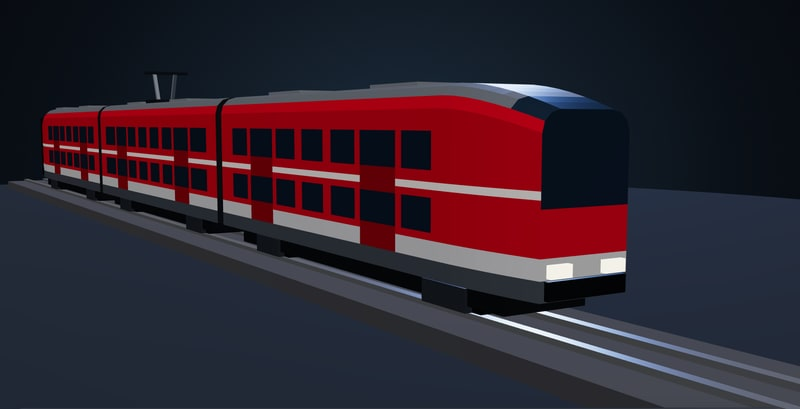 | 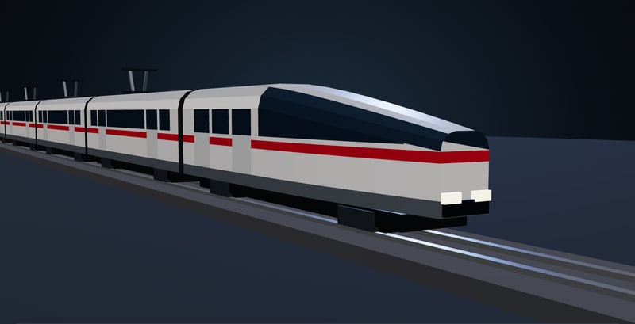 |

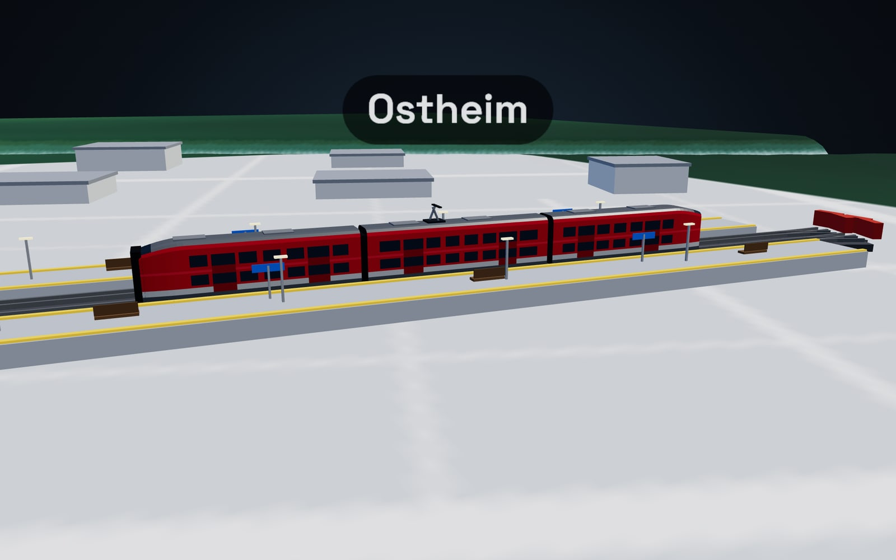

### Auch auf dem Handy

| Karte | Netzplan | 3D |
|---|---|---|
| 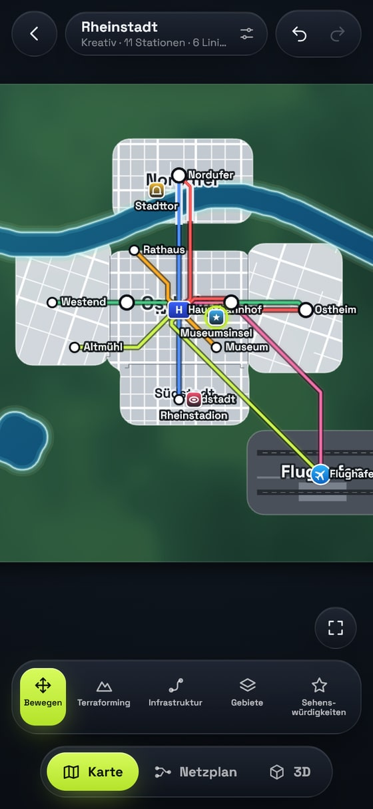 | 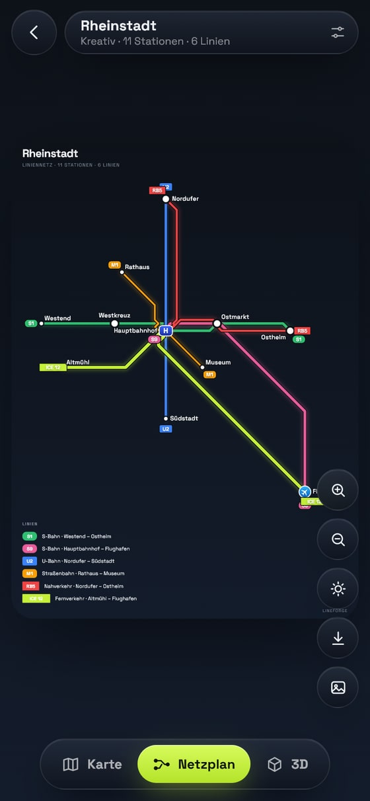 | 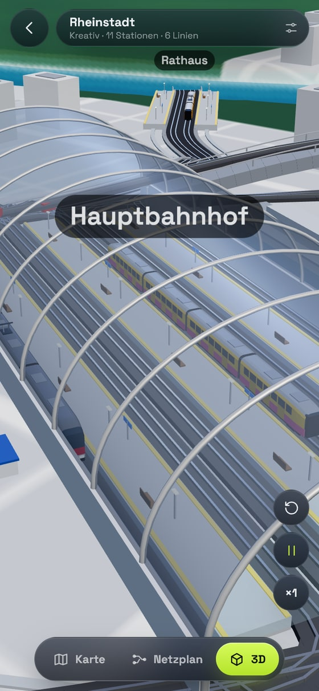 |

## Modi

- **Kreativ:** frei bauen, ohne Störungen.
- **Normal:** gedacht für Probleme wie Unfälle, Bauarbeiten und wachsenden Bedarf. Der Modus wird bisher nur gespeichert, die Ereignisse folgen.

Es gibt kein Geld und keine Wirtschaft, LineForge ist ein Werkzeug zum Gestalten.

## Entwicklung

```bash
pnpm install
pnpm dev      # http://localhost:5173
pnpm test     # Vitest
pnpm lint     # Oxlint
pnpm build    # Typecheck + Produktions-Build (inkl. PWA)
```

Städte werden automatisch im Browser gespeichert (IndexedDB) und lassen sich als JSON exportieren und importieren.

### Aufbau

| Ordner | Inhalt |
|---|---|
| `src/model` | Datenmodell, Routing, Bahnhofs-Entwurf, Fahrzeuge |
| `src/editor2d` | Karteneditor (Canvas), Terrain, Gebiete, Straßenraster |
| `src/plan` | Netzplan (SVG), Layout und Beschriftung |
| `src/view3d` | 3D-Ansicht: Gleise, Bahnhöfe, Züge, Gebäude |
| `src/store` | Zustand und Undo/Redo |
| `src/persistence` | Speichern und Import/Export |

### Stack

Vite, React 19, TypeScript, Tailwind 4, Zustand + Immer, Canvas 2D für die Karte, three.js über @react-three/fiber für 3D, Dexie (IndexedDB) und vite-plugin-pwa.

## Stand und Ausblick

Fertig sind Karteneditor, Netzplan, 3D-Ansicht mit Zügen, Bahnhofs-Editor und Fahrzeug-Galerie. Als Nächstes geplant: Ereignisse im Normal-Modus, Untergrund-Ansicht für die U-Bahn, Follow-Kamera für Züge, Statistik-Ansicht und fertige Beispielstädte.
